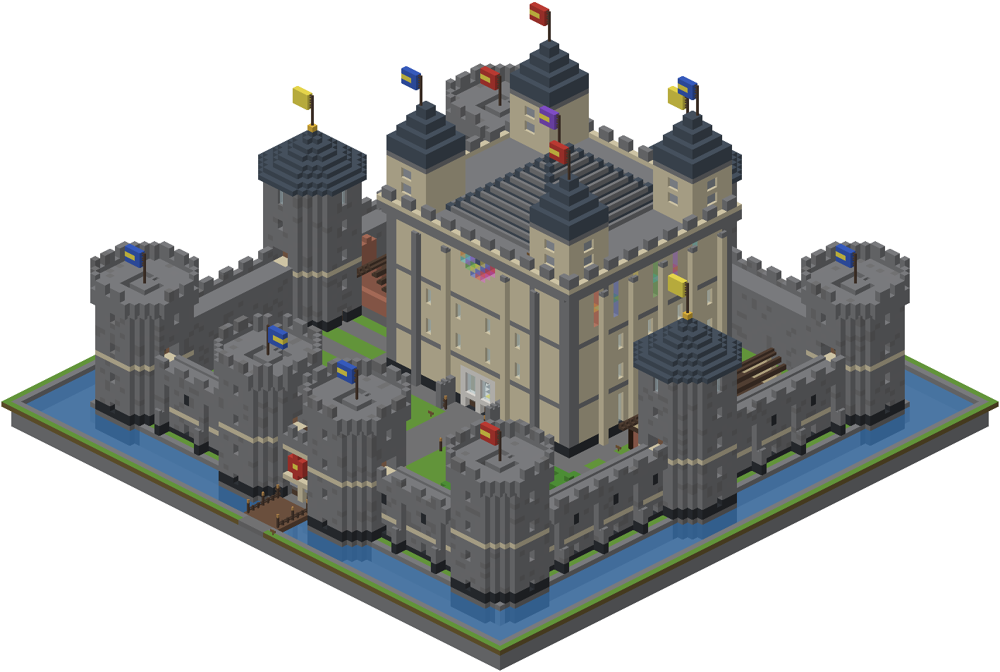

# Castillo

En campo abierto puedes toparte con un **castillo**: un cuadrado de altas murallas de piedra de unos **100 bloques** de lado, con un foso de agua alrededor, nueve torres con banderas, un patio lleno de vida y, en el centro, una torre clara más alta que todo lo demás: la **torre del homenaje**. Está inspirado en los castillos de la Edad Media europea, pero no es una copia de ninguno.

## Un poco de historia de verdad

Durante unos quinientos años, del siglo X al XV, un castillo era a la vez casa y fortaleza: allí vivía el señor con su familia, sus soldados y sus criados, y la gente de los alrededores corría a refugiarse en él cuando había peligro.

- **Los primeros castillos eran de tierra y madera.** Los normandos levantaban un montículo de tierra (la *mota*) con una torre de madera encima y un recinto cerrado por una empalizada. Se hacían deprisa: en unas semanas.
- **Luego llegó la piedra.** La madera arde y la piedra no. Hacia 1078 Guillermo el Conquistador empezó en Londres la **Torre Blanca**, una torre cuadrada de piedra que sigue en pie.
- **Murallas dentro de murallas.** En el siglo XIII los mejores castillos tenían dos anillos de murallas, uno dentro del otro, como **Beaumaris** en Gales o el **Krak de los Caballeros** en Siria: quien rompía el primero quedaba atrapado delante del segundo.
- **España es tierra de castillos**: el reino de **Castilla** se llama así por ellos, porque su frontera estaba llena. El Alcázar de Segovia, sobre una roca entre dos ríos, y el castillo de ladrillo de Coca son dos de los más famosos.
- **La pólvora acabó con ellos.** Desde el siglo XV los cañones podían derribar cualquier muralla, y los castillos se fueron convirtiendo en palacios, cárceles o ruinas.

La torre principal se llama *del homenaje* porque allí los vasallos se arrodillaban y juraban fidelidad a su señor: le rendían homenaje.

## Cómo leer las defensas

| Parte | Qué es | Para qué servía |
|---|---|---|
| **Foso** | Una zanja llena de agua alrededor de las murallas | Frena escaleras, torres de asedio y a quien intenta cavar túneles bajo los muros |
| **Lienzo de muralla** | El muro entre dos torres | Para que nadie entre; por arriba corre el **adarve**, el camino de ronda |
| **Almenas** | Los dientes de lo alto de un muro | El diente (*merlón*) protege al arquero; el hueco (*tronera*) le deja disparar |
| **Matacanes** | Un parapeto que sobresale sobre ménsulas de piedra | Por los huecos de su suelo se dejaban caer piedras sobre quien estaba al pie del muro |
| **Saeteras** | Aberturas altas y muy estrechas | Anchas por dentro y estrechas por fuera: el arquero apuntaba bien y era un blanco diminuto |
| **Rastrillo** | Una reja que baja deslizándose delante de la puerta | Para cerrar el paso en un momento, aunque rompieran las puertas |
| **Torres de la puerta** | Dos torres que guardan la entrada | La puerta es el punto más débil, así que era el más defendido |

## Un paseo por el castillo

### Puente y puerta

Un **camino** lleva a la única entrada: un **puente de madera** sobre el foso, apoyado en pilares de piedra, con barandillas y antorchas. El foso tiene tres bloques de hondo, con orillas y fondo de piedra. Al final está la **puerta**, entre dos torres con banderas azules: dos pares de puertas de roble oscuro y, encima, el **rastrillo** de  barrotes de hierro, subido. Sobre el paso hay una sala, y en lo alto matacanes, almenas y un estandarte rojo y amarillo. Con las puertas cerradas no entra nadie, y el foso para a quien intenta rodearlo a nado.

### Las murallas y las torres

Los **lienzos** son gruesos: por dentro, al pie, corre una **galería** con saeteras cerradas con barrotes; encima, dos capas de piedra; arriba, el **adarve** con su parapeto sobre ménsulas, y por fuera contrafuertes escalonados. La piedra mezcla  ladrillos de piedra, piedra y adoquín, como los muros viejos remendados durante siglos, sobre un zócalo oscuro de  basalto.

Hay **nueve torres**, todas **octogonales**: cuatro en las esquinas, con la azotea plana tras un parapeto (banderas rojas y azules), tres en el centro de los lados con un **cono de**  **pizarra**, punta de oro y bandera amarilla, y las dos de la puerta. Cada una tiene cinco plantas, con saeteras y  faroles, y una **escalera de caracol** que sube girando alrededor de un pilar de piedra. Puertas al patio, a la galería y al adarve lo unen todo: se puede dar la vuelta entera al castillo por lo alto de sus murallas.

### El patio de armas

- **Jardín y pozo**, a la izquierda de la puerta: parterres de flores, arbolitos, bancos y en el centro un **pozo** de piedra con tejadillo de madera y [agua](52) profunda. En un asedio, un castillo sin pozo caía en pocos días.
- **El mercado**, a la derecha: seis puestos bajo toldos de rayas, con flores, setas, jarrones y macetas en los mostradores y un barril detrás de cada uno.
- **Las cuadras**: una nave de  ladrillo y madera con establos tras portillos de valla, heno y un barril en cada uno.
- **La forja**: piedra abajo, ladrillo arriba y una chimenea alta; tres  hornos hacen de fragua, junto a una mesa de trabajo, cofres y barriles.

Unos carteles en postes nombran cada sitio en español y en inglés.

### La torre del homenaje

Es de  caliza sobre un zócalo oscuro, con muros de dos bloques de grosor, y se entra subiendo unos escalones por una portada enmarcada en  mármol. Dentro, una escalera de caracol en una esquina va de la mazmorra a la azotea.

| Planta | Qué hay |
|---|---|
| **Mazmorra** (bajo tierra) | Un pasillo con **ocho celdas**, cada una tras un muro de barrotes y una  puerta de hierro |
| **Planta baja** | El **gran salón**: suelo de mármol a cuadros, alfombra roja, dos mesas largas con sillas y  velas, columnas con colgaduras rojas y amarillas,  candelabros colgados de cadenas y, al fondo, un **trono** con respaldo de oro sobre un estrado con escalones. Detrás, la **cocina**: una fila de hornos bajo una campana de ladrillo, una mesa larga, taburetes, fregadero, barriles y cofres |
| **Dormitorios** | Un pasillo con alfombra azul y **siete dormitorios**, cada uno de su color, con  cama, mesilla con lámpara, armarios y cofres. Al fondo, la **cámara real**: dos camas, cortinas moradas, un escritorio y cuadros |
| **Biblioteca y armería** | Hileras de  estanterías y mesas de lectura; tras una puerta de hierro, la **armería**, con cofres, barriles, baldas y armeros de hierro |
| **Capilla** | Una sala alta con ventanales de [vidriera](229) en seis colores y un **rosetón** redondo en cada extremo, bancos, columnas y candelabros |
| **Azotea** | Un camino tras almenas sobre ménsulas, un **torreón** con tejado de pizarra en cada esquina y el tejado de pizarra de la capilla, con remate de oro y bandera morada |

## Luz sin electricidad

Un castillo medieval no tenía electricidad, y este tampoco: de noche lo alumbran  faroles,  velas, antorchas, lámparas de pie y de mesa y candelabros. Todas son [luces sin electricidad](228). Fíjate en cómo un solo farol colgado ilumina una planta entera de una torre.

## Qué hay en los cofres

Cada cofre, barril y armario del castillo guarda lo que necesita su sala. Cada barril del mercado tiene su oficio: pan y queso, pescado salado, miel y velas, lana, macetas y jarras, setas. Las cuadras guardan trigo para los caballos; la forja, carbón y mineral en los barriles y herramientas y lingotes en los cofres; la cocina, trigo, sal, queso, miel y los platos y jarras del salón. En los dormitorios hay abrigos, lana, cuero y velas, y en la cámara real pieles, pan de oro y alguna gema. La armería guarda espadas de hierro, escudos y cotas de escamas, con antorchas y provisiones en los barriles, y el barril de la mazmorra, pan y cubos para los presos. Dos cofres seguidos casi nunca guardan lo mismo.

## El rincón de la ciencia

- **¿Por qué torres octogonales?** Una esquina en ángulo recto se derriba con facilidad y deja un punto ciego que los arqueros no ven. Una torre redonda o de muchos lados desvía las piedras y deja vigilar todo alrededor.
- **¿Por qué escaleras de caracol?** Ocupan muy poco y se pueden defender escalón a escalón. Mucha gente cuenta que giraban para que un defensor diestro que bajaba pudiera blandir la espada sin chocar con el muro; los historiadores no se ponen de acuerdo, porque muchas giran al revés.
- **Agua que se queda.** En este juego el agua no se escapa, así que el foso y el pozo siguen llenos sin desagüe.
- **Piedra y cal.** Los castillos de verdad se unían con mortero de cal, que se hace quemando caliza: mira [Cal viva](183).

## Curiosidades

- Algunos castillos se levantaron en pocos años; otros tardaron un siglo y nunca se terminaron.
- Los muros de muchas torres del homenaje eran más gruesos de lo que mide de alto una persona adulta: frescos en verano y templados en invierno.
- Las torres de las esquinas dejan ver a lo largo de todo el lienzo: a quien intentaba trepar se le veía de lado.

Ver también: [Ladrillos](57), [Piedras nobles y metales](59), [Escaleras](196), [Puertas y trampillas](197), [Vidrieras](229), [Luces sin electricidad](228), [Cofres y armarios](226), [Índice de muebles](223), [Agua](52).
