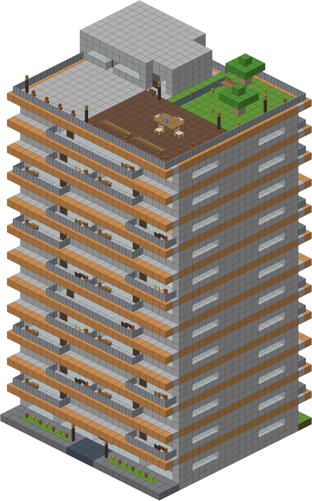

# Bloque de pisos

Un edificio alto y moderno, de **24 bloques de ancho y 18 de fondo**, con balcones por los dos lados y un jardín en la azotea: un **bloque de pisos**. Sobre el portal hay **11 plantas de viviendas**, 31 pisos en total, unidas por una escalera y por un **ascensor que funciona de verdad**.

## Vivir unos encima de otros

Construir hacia arriba pone a muchas familias en un trozo pequeño de terreno, cerca de las tiendas, los colegios y el trabajo.

- **La antigua Roma** ya tenía bloques de pisos, las *insulae*, de hasta seis o siete plantas, tan altas y tan mal construidas que el emperador Augusto limitó su altura a unos 20 metros.
- En España, las **corralas** de Madrid eran bloques de viviendas pequeñas alrededor de un patio, con largos corredores abiertos donde se encontraban los vecinos.
- Los edificios altos de hoy solo fueron posibles gracias a dos inventos del siglo XIX: las **estructuras de acero** y el **ascensor seguro**. En 1854 Elisha Otis se subió a la plataforma de un ascensor delante de una multitud y mandó cortar la cuerda: un freno paró la caída al instante. El primer ascensor de pasajeros con su freno se instaló en una tienda de Nueva York en 1857.

## Un paseo por el edificio

### El portal

Por una fachada de cristal con dos puertas dobles se entra a un vestíbulo con suelo de  mármol y basalto. Hay sofás y plantas junto a la ventana, una mesa para el portero, un reloj, un candelabro y, en la pared lateral, baldas para los **buzones**. Un cartel te recibe: *Bienvenido a casa*. Detrás del portal hay una **sala común** para los vecinos, con una mesa larga y sillas, sofás verdes y estanterías.

### Para subir

- **La escalera** sube por detrás, media vuelta por planta, hasta la azotea.
- **El ascensor** va del portal a la **planta 11**. Sobre cada puerta del ascensor hay una  **parada de ascensor**, que también es el botón de llamada: **apagada** mientras el ascensor está libre, **ámbar** mientras está llamado y **verde** cuando ha llegado. La puerta de hierro de debajo se abre sola cuando llega y se cierra cuando se va, así que nadie puede meterse en el hueco vacío.
- Dentro del ascensor, un botón **verde** lo manda arriba y uno **rojo** abajo, al portal; por el camino, toca la parada de tu planta cuando pase. **Manda la última llamada**: el ascensor va directo allí.

Cada planta tiene su color en la alfombra del pasillo, en su cartel y al fondo del hueco: blanco el portal y luego amarillo, naranja, rojo, rosa, magenta, morado, azul, celeste, turquesa, lima y verde para la planta 11. Así siempre sabes dónde estás.

### Los pisos

En cada planta hay dos pisos delante y uno detrás; las plantas **5** y **11** tienen delante, en su lugar, un solo **piso grande**. No hay dos iguales: hay siete estilos, cada uno con sus colores de sofá, alfombra, cortinas, suelo, paredes y baño, y la cocina, la bañera y la cama cambian de sitio de un piso a otro.

| Habitación | Qué tiene |
|---|---|
| **Salón y cocina** | Un sofá, una  nevera, un  horno y un  fregadero, cortinas, un cuadro o un reloj y, en algunos, una estantería o sillas. Los pisos grandes tienen mesa para seis, un escritorio y más sofá |
| **Balcón** | Su puerta, una barandilla, una maceta, una silla o un banco y una luz |
| **Baño** | Un  váter, una  bañera y un lavabo con un  espejo encima |
| **Dormitorio** | Una  cama, un  armario y una mesilla con lámpara |

### La azotea

Arriba de la escalera, una puerta da a la **azotea**, tras una barandilla: a un lado, una **tarima** de madera con bancos mirando al paisaje, una mesa, lámparas y macetas; al otro, un **jardín** de césped con dos abedules pequeños, flores y un camino de pizarra hasta un banco. Sobre el núcleo del edificio está el **cuarto de máquinas**, con una ventana para ver el torno que tira del ascensor.

## Qué hay en los cofres

Todos los pisos tienen la despensa y el armario llenos, y no hay dos iguales. La nevera guarda leche y algo de queso, agua fría, refresco, pan, miel, pescado o setas asadas, con hielo y pescado o pan congelado en el congelador; las neveras no están conectadas, así que sirven de armario, pero nada de lo que guardan necesita el frío. Cada armario tiene un abrigo y algo de lana, cuero, un costurero, velas o una herramienta: un hacha, unas tijeras, una caña de pescar, una red para bichos. Los hornos están apagados.

## El rincón de la ciencia

- **Por qué el ascensor para en la planta 11.** El ascensor es una plataforma que sube un **torno** con su propio generador RTG (60 de sus 80 W). Un torno sujeta como mucho **48 bloques** de cuerda y se para 2 por debajo de sí mismo, así que la plataforma recorre 46 bloques como máximo. Las plantas están a 4 bloques: 11 plantas son 44 bloques, 12 serían 48. Por eso el último tramo, hasta la azotea, es de escalera. Mira [Ascensores](218).
- **Ahorrar terreno.** Haz la cuenta: 31 pisos caben en el terreno de tres o cuatro casitas. Con casas una al lado de otra haría falta una calle entera.
- **Las paradas son lógica.** Las paradas, las puertas y los botones no gastan nada de electricidad: son señales, como las [puertas lógicas](209).

## Curiosidades

- En España la planta de la calle es la *planta baja* y la de encima el *primero*; en Estados Unidos la de la calle ya es el primer piso.
- Con balcones por los dos lados del edificio, cada piso, delante o detrás, tiene su propio balcón y sus propias vistas.

Ver también: [Ascensores](218), [Generador de radioisótopos](220), [Índice de muebles](223), [Cocina y baño](227), [Sillas y sofás](224), [Espejos](232), [Alfombras y cortinas](230), [Puertas y trampillas](197), [Ventanas](198).
