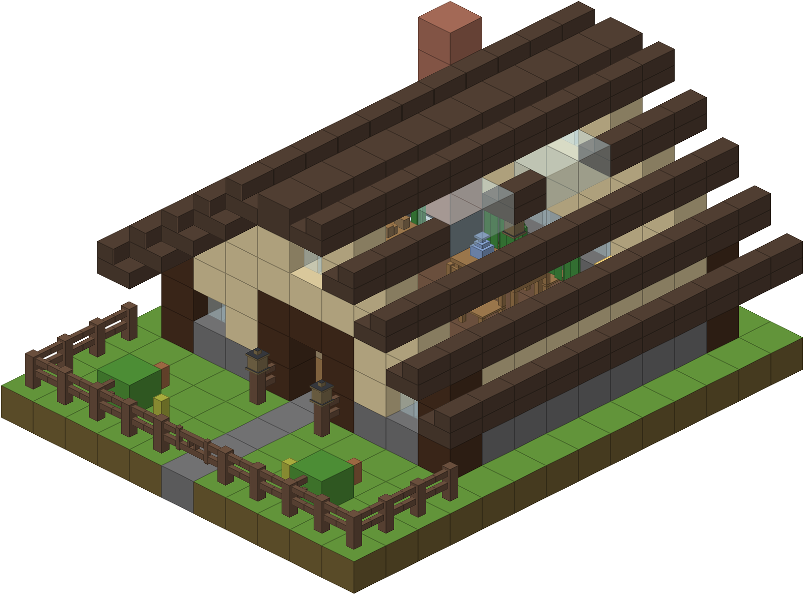

# Small house

A **cottage** of timber with a stone base and a steep dark roof, in a yard with a fence and flowers: the smallest home you can find in the world, **11 by 14 blocks** with its yard. It has just one room, but everything a person needs to live is in it.

## Timber houses

For centuries, in much of Europe, houses were built with a **frame of wooden beams** filled in between with clay, brick or planks. You can still see them in old villages, in Spain and all over the north of Europe, with their dark beams showing on the walls.

- The **stone base** (the *plinth*) keeps the wood off the wet ground, so that it does not rot.
- The **steep roof** lets rain and snow slide off at once.
- The **chimney** takes the smoke out: hot air is lighter than cold, so it rises up the flue by itself.

This one is inspired by those cottages: walls of  birch planks on a  cobblestone plinth, posts of spruce at the corners and round the door, and a gable roof made of  dark oak stairs.

## A walk through the house

A cobbled path goes from a gate in the fence, between flowers and two lamp posts, to the front door, in a timber frame. Inside there is **one room of 7 by 7**:

| Corner | What there is |
|---|---|
| **Kitchen**, along one side | An  oven under a brick chimney, a  sink, a workbench with a shelf above it, a  fridge and a barrel |
| **Dining**, at the back | A table for four under the back window, with a candle and a vase |
| **Bedroom corner**, on the other side | A  bed with its head to the wall, a bedside table with a lamp, a chest, a  wardrobe and two paintings |
| **Sitting corner**, by the door | A green sofa on a red carpet, a floor lamp, a clock over the door, a [mirror](232) beside it and a bookshelf with a flower pot on top |

The windows have green curtains; they are drawn back by day except the one by the bed. Right click a curtain to draw it. Light comes in through **roof lights** of glass, because the deep eaves would otherwise leave the middle of the room dark, and at night two [lanterns](228) hang under the roof: the room is too low for a chandelier.

There is **no bathroom**: it would take a wall and a quarter of the room. Old cottages often had none either.

## The fridge that works

The fridge is not decoration. Under it, hidden in the floor, there is an  [RTG](220): a generator that touches the fridge and nothing else. The fridge uses **30 W** and the generator gives **80 W**, so this tiny [network](200) never runs out. It is the simplest electric circuit you can find: one generator, one consumer. See [Fridge and freezer](234).

## What the chests hold

The fridge holds cold milk, cold water and cheese, with ice and frozen fish in its freezer; the barrel bread, wheat, salt, roast mushrooms and the plates and jug. The chest keeps an axe, shears, a fishing rod, seeds, candles and torches, and the wardrobe a warm coat, wool, leather and a sewing basket. The oven is unlit: light it to cook.

## What to learn here

- **A kitchen in a triangle.** Oven, sink and fridge are a step apart: cooks say a kitchen works best when those three make a small triangle.
- **Energy.** 30 W of 80 W: how many fridges could that generator feed? (Two, with 20 W left over.)
- **Light.** Compare the room by day, with its roof lights, and by night, with only two lanterns.

See also: [Furniture](223), [Kitchen and bath](227), [Chests and wardrobes](226), [Carpets and curtains](230), [Oven](233), [Bed](63), [Wood and leaves](54), [Stairs](196).
