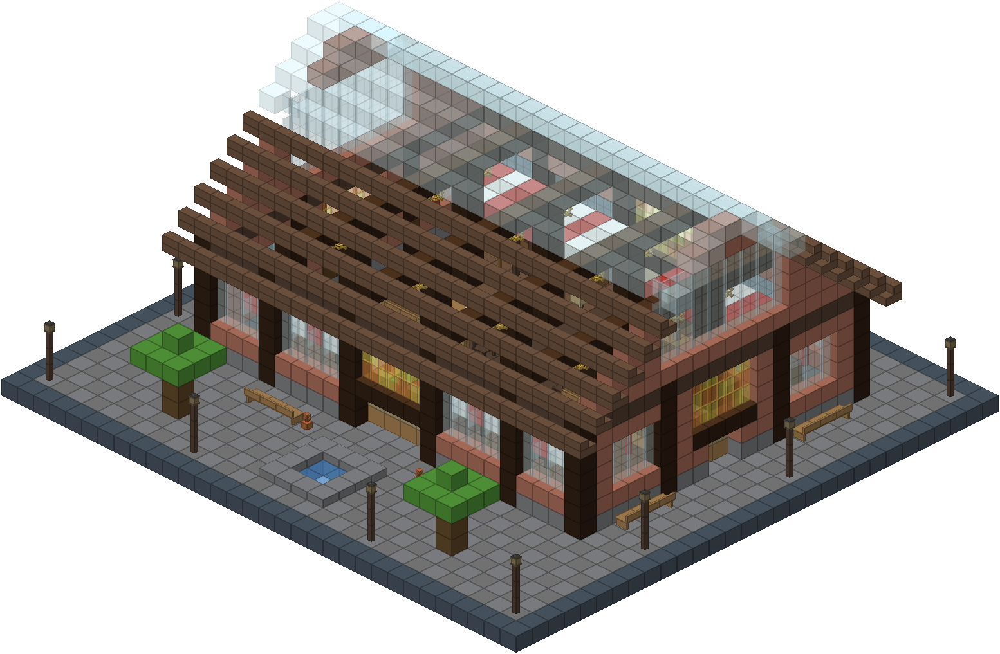

# Community hall

In the middle of a paved square, **32 by 30 blocks**, stands a long hall of  brick with wide doors on all four sides and a tall roof with glass along its ridge: a **community hall**. It is a covered market on most days, and a place where neighbours meet, eat together and celebrate on the others.

## Halls and markets

Towns have always needed a roof under which to buy and sell, whatever the weather.

- In the Middle Ages many towns had a **market hall**: a great roof on wooden posts, open at the sides, often with the town council meeting in a room above.
- In the 19th and early 20th centuries came the market halls of **iron and glass**, full of light: in Madrid the **Mercado de San Miguel** (1916) is one of them, and Barcelona's **Boqueria** got its iron roof in 1914.
- Many villages in Spain still have their **casa del pueblo** or *salón de actos*, where people hold meetings, dances, plays and fairs.

This hall is inspired by those buildings: brick walls on a base of stone, dark wooden columns and beams inside, and a roof that lets in the sky.

## A walk round the hall

### The square

The square is paved in a check of stone bricks and cobblestone with a slate border. In front of the main door there is a small **fountain** of [water](52). Trees, flower pots, street lamps with  lanterns on posts, and  benches with their backs to the hall, looking out at the square.

### The building

- **Walls** of brick on two courses of  stone bricks, with **dark oak posts** every few blocks and windows between them; the windows of the short walls have red curtains, drawn back.
- **Doors on all four sides**: four leaves at the front, two at the back and two on each side, each with a **fanlight** of orange and yellow [stained glass](229) above it.
- **Inside**, rows of dark oak columns hold **tie beams** across the hall, and under the beams hang  chandeliers.
- **The roof** climbs from both sides to a ridge; near the top it is of **glass**, which lights the middle of the hall by day, and the two gable ends have tall windows too.

### Inside

| Where | What there is |
|---|---|
| **Along the front and back walls** | **Eight market stalls**: a counter between two posts under a red and white striped awning that runs back to the wall, a lane behind to serve from, a barrel and a chest for the stock, a lantern and a coloured mat for the customer. On the counters: flower pots, vases, mushrooms, flowers and candles |
| **In the middle** | **Two long tables** with benches on both sides and a pair of chairs at the end, candles, vases and flower pots on them, floor lamps beside them |
| **On the walls and columns** | Paintings, a clock and more flower pots |

The middle of the hall stays free from door to door, so that people can walk straight through.

## What the chests hold

Each stall's barrel holds more of what it sells: pots and vases with seeds, mushrooms, honey and wheat, or candles and lanterns. The chests keep what the hall needs for a feast or a fair: plates, jugs and candles in all of them, and in each a few more things, such as tea sets, fruit bowls, lanterns, wool for bunting, bread, cheese or soda. With some friends you can turn it into a real market, each one with a stall.

## What to learn here

- **Why tie beams?** A pitched roof pushes its walls outwards, as a book standing open on its edges slides apart. A beam across, tying one wall to the other, stops them from spreading. Look up: every pair of columns is joined by one.
- **Light from above.** The walls can only light the edges of a wide room; glass near the ridge brings daylight into the middle. Compare the light at the stalls and at the tables.
- **Market maths.** Plan a market day: what each stall sells, how much it charges, and what you get back in change.

## Curiosities

- The Spanish word *lonja* was the name of the old trading halls, like the Lonja de la Seda in Valencia, where silk was bought and sold from the 15th century.
- In many villages the market day is still the same day of the week it was centuries ago.

See also: [Bricks](57), [Stained glass](229), [Doors and trapdoors](197), [Windows](198), [Tables](225), [Chairs and sofas](224), [Paintings, clock and ornaments](231), [Playing together](13).
