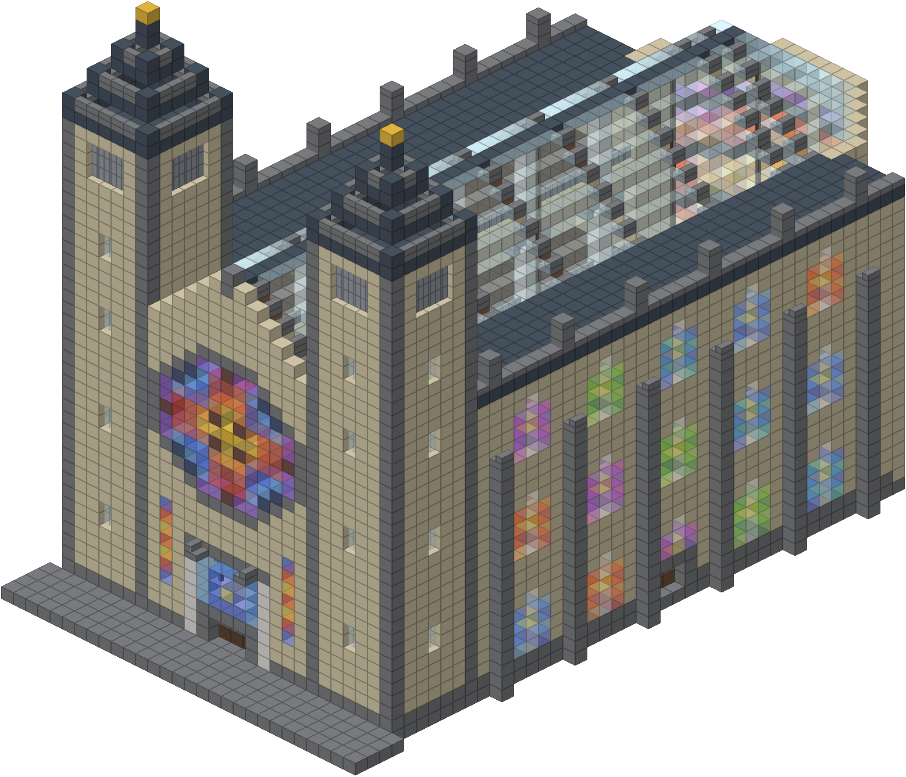

# Cathedral

Two towers with slate spires, a great round window of coloured glass between them and, behind, a long, tall building of pale stone full of light: a **cathedral** in the **Gothic** style. It is **29 blocks wide and 54 long**, and its spires rise about 46 blocks over the ground. It is inspired by the great Gothic cathedrals of Europe, but it is a design of its own. Here we look at it as a work of **architecture and engineering**: how stone was made to stand so high and let in so much light.

## The Gothic style

Before the 12th century, big stone buildings had thick walls with small windows, because the walls had to carry the whole weight of the roof. Around 1140, at the abbey of **Saint-Denis**, near Paris, builders joined several ideas together and started a new style, which spread across Europe for four hundred years. Its tricks:

| Invention | What it is | Why it matters |
|---|---|---|
| **Pointed arch** | An arch that ends in a point instead of a half circle | It sends the weight more steeply down into its pillars and pushes less sideways, so buildings could be taller; and its height can be chosen whatever its width |
| **Rib vault** | A ceiling held by crossing ribs of stone, with thin panels between them | The ribs carry the weight down to a few pillars, so the walls between them no longer carry it |
| **Flying buttress** | A half arch outside the building, from a tall pier to the top of the wall | It pushes back against the vault, which tries to spread the walls apart. With it the walls could be almost all glass |
| **Pinnacle** | A small stone spire on top of a buttress | Its weight presses the buttress down and helps it resist the push |
| **Rose window** | A great round window of stained glass, with a pattern like a flower or a wheel | The jewel of the front, made possible because the wall no longer carries so much |

Some famous Gothic buildings: **Notre-Dame de Paris** (begun in 1163), **Chartres**, famous for its blue glass, and in Spain **Burgos**, **Toledo** and **León**, nicknamed the "house of light" because it has more stained glass than stone in many of its walls.

## What this cathedral has

Look for the Gothic ideas in it, and for the ones it does differently:

- **Buttresses** of stone stand against its outer walls, one at each pillar, stepping back at the top. They are fixed to the wall, not flying.
- Each pair of  **marble piers** is joined by **arches** that narrow towards the top, on three levels.
- The roof of the nave is held by **ribs** of stone with **glass** between them, so daylight falls into the middle of the building, as in a vault whose panels were made of light.
- **Pinnacles** stand on the parapet of the aisle roofs, one over each pier.
- A **rose window** of real [stained glass](229) over the main door.
- **Tall windows**, one in each bay and on each storey, filled with stained glass.

## A walk through the cathedral

### The front

A stone forecourt leads to the **front** (in real cathedrals the main front usually faces west, towards the sunset). The door is framed by marble pillars, with stained glass in blue, light blue and yellow over it and narrow strips of red, yellow and blue glass at its sides. Above it is the **rose window**: from the middle, a gold centre, a star of yellow and orange, petals of red and blue, and an outer ring of light blue and purple with **twelve lamps** set in it like the hours of a clock. The lamps are [neon](125) and [argon](126) lamps: they glow by day and by night, but give no light to the room.

### The nave and the aisles

- **The nave** is the tall central space. Its floor is of marble and basalt in a check, with a red carpet up the middle, and **long benches** on both sides face the far end.
- On each side, a row of six **marble piers** separates the nave from the **aisles**, the lower passages along the outer walls. Over each aisle there are **two galleries**, one above the other, with railings towards the nave: from them you look down on the whole building.
- **Crowns of chandeliers**, five chandeliers each, hang on chains from the ridge, low enough to light the floor; lanterns stand on stone brackets on the walls and on the piers.
- A door on each side opens into an aisle.

### The windows

Each tall window has two colours in a check down its sides and a pale light down the middle with a **yellow medallion**, and the colours change from bay to bay and from storey to storey: blue and light blue, red and orange, purple and magenta, green and lime, cyan and blue. Walk along an aisle at different times of day and watch the colours against the sky.

### The chancel and the apse

At the far end, steps across the whole nave lead up to the **chancel**, a raised floor of marble, with candles and candlesticks, a lantern and chairs along the wall. Behind it the building ends in the **apse**, a rounded end whose walls are almost all glass: rings of colour from yellow in the middle out through orange, red and purple to blue, like a sun rising.

### The bell towers

Each of the two towers has a **spiral stair** round a solid core, with narrow windows. It passes doors to the two galleries and climbs to the **belfry**, with open arches closed by iron bars and a **bell**: a  [sound block](66) tuned to the bell. Ring it! Above, a **spire** of  slate narrows to a gold tip.

## What the chests hold

The cathedral has no chests or barrels: it is a building to look at, climb and listen in.

## The science corner

- **Coloured glass is chemistry.** Glass is coloured by adding a little metal while it is melted: **cobalt** gives blue ([Cobalt glass](185)), **copper** green or red, **gold** a ruby red. Medieval glaziers joined the pieces with strips of lead.
- **A bell is bronze**, copper and tin ([Bronze](121)): a hard metal that rings for a long time when struck.
- **Forces.** A stone arch stands because every stone presses on its neighbours: the weight goes round the arch and down into the pillars. Remove the central stone (the *keystone*) and it falls.
- **Echo.** In a long, tall hall of stone a sound bounces from wall to wall and lasts for seconds. Clap your hands in the nave and listen.

## Curiosities

- Many Gothic cathedrals took more than a century to build: the people who laid the first stones never saw them finished. Cologne Cathedral, begun in 1248, was only completed in 1880.
- Builders had no calculators: they worked out their arches with ropes, compasses and simple shapes like circles and triangles drawn full size on the floor.

See also: [Stained glass](229), [Fine stones and metals](59), [Stairs](196), [Sound block](66), [Neon lamp](125), [Argon lamp](126), [Cobalt glass](185), [Lights without electricity](228), [Light and darkness](105).
