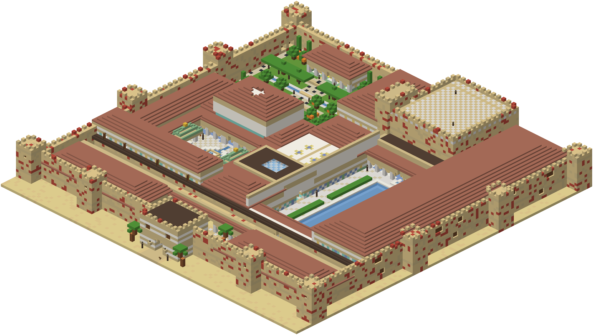

# Andalusian palace

In the desert you may come across a long, low wall of sandstone with patches of red, square towers with battlements and a gate under a horseshoe arch. From outside it looks plain, almost like a fort. A sign by the road gives its name: **Alcázar del Agua**, the Palace of Water. Go in: all its beauty is inside, in courtyards full of water, tiles and light.

## What inspired it

It is inspired by the **Alhambra** of Granada, in the south of Spain, the palace of the **Nasrid** kings, who ruled there from 1238 until 1492. It is not a copy: its rooms are laid out in its own way, but they carry the names and ideas of the real ones.

- The name *Alhambra* comes from the Arabic *al-Ḥamrāʼ*, "**the red one**", for the colour of its walls. That is why the outer wall here has patches of  red lime stucco among the  sandstone.
- The Nasrid palaces were **plain outside and splendid inside**. Courtyards follow one another along paths that **turn corners**, so each one is a surprise; you never see the whole palace at once.
- Water was everywhere: pools, fountains and channels, carried down from the mountains. Here too, almost every court has its water.

## A walk through it

**The forecourt and the gate.** A paved way runs from the road to the gate between palms and lamps. The gate tower has a passage under a horseshoe arch framed in tiles, a guard post on each side and the guards' room upstairs.

**The front band**, next to the gate:

- The **oratory**, the place of prayer: two rows of columns, carpets laid in rows, a great lamp and, in the far wall, a tiled niche (the *mihrab*) that shows which way to face.
- The **Mexuar**, the hall where the council met: four columns hold up a little tower of glass that lets light into the middle, benches line the walls, and the sultan's seat of cushions stands on a step at the end.
- The **entry court**, open to the sky, with a fountain in the middle, two palms and an arcade.
- The **guards' quarters**, with bunks and their chests, and the **stables**, with stalls, troughs of water and hay.

**The lane.** Behind the front band runs a long paved street with lamps on posts, the *Calle Real*. From it you reach the palaces.

**The west wing.** The kitchen (ovens, a long worktable, sinks), the stores with rows of barrels, the servants' hall, and the women's salon with cushions round a fountain. A stair climbs to a corridor that looks over the Court of the Myrtles through wooden lattices. Off it open five suites: a dressing room with its wardrobe, a small washroom (a bath, a toilet and a basin), the bedroom by the outer wall and, behind it, a closet or, in one of them, the nursery. The sultana's is the largest.

**The Court of the Myrtles.** A long court of marble with a **pool down the middle** between two green hedges of myrtle and a round fountain at each end. Porticoes of slender columns close its two short sides. The still water reflects the tower at the far end, just as in Granada.

**The Comares tower.** Through the **Sala de la Barca**, whose ceiling is shaped like an upturned boat, you reach the tallest tower and its **throne hall**: tiles in eight-pointed stars on the floor, bands of carved stucco on the walls, three windows (*miradors*) in the far wall and a **coffered wooden ceiling** in steps, for the seven heavens. The  throne stands on a dais under the middle window, with banners and cushions along the walls. A stair well beside the tower climbs to the library and on to the tower's **roof terrace**, the best view of the whole palace.

**Between the two courts:** the **Hall of Tilings** (the science room, below), the **baths**, a vestibule with marble busts, the **treasury** with its floor of gold and marble squares, the royal store and, upstairs, the **library**, with shelves along the walls and desks under lattice windows over the garden.

**The baths (hammam).** A rest hall with sofas round a fountain under a lantern of glass, then two vaulted rooms, warm and hot, with pools and **star-shaped skylights**. Glowing  magma rock under the floor stands for the furnace that warmed the real ones from below.

**The Court of the Lions.** A court crossways to the first one, with an arcade all round of single and paired columns and a pavilion with a green tile roof at each end. In the middle, the **fountain of the twelve lions**: a ring of carved stone round a pedestal, water round it, and **four channels** going out to the four sides. Around the court:

- The **Hall of the Two Sisters**, the audience hall, very high, with a dome of stepped tiles round a star of glass.
- The **Hall of Kings**, the banquet hall, with alcoves onto the court and a ceiling painted red and white. Behind it are a small privy, the store of the table linen and the chamberlain's office, which you enter from an alcove of the Two Sisters.
- The **Abencerrajes** room, for music, with cushions round a little fountain under a star-shaped lantern, a pantry beside it and, upstairs, the rooms of the sultan (an antechamber, his bedchamber and his washroom), the prince and the princesses.

**The garden.** Beyond the palace, inspired by the **Generalife**, three terraces climb away from the buildings: orange trees in beds edged with myrtle, cypresses, a channel with a fountain and a bridge, a long pool with jets of water, a pergola of leaves and, at the top, a **mirador** with cushions, looking back down the garden.

## The science corner: the Hall of Tilings

Nasrid artists covered walls and floors with **tessellations**: tiles of the same shapes that fit together with **no gaps and no overlaps**. They did it with geometry, and without knowing it they explored a piece of mathematics that was only proved centuries later.

**There are only 17 ways** to repeat a pattern over a flat surface for ever: the **17 wallpaper groups** (proved in 1891). Each way mixes the same few moves: **sliding** the pattern, **turning** it round a point, and **mirroring** it. People often say all 17 can be found in the Alhambra; experts still argue about a few of them.

The floor of the hall has **four panels**. In each, the same little shape, a crooked hook that has no symmetry of its own, is repeated in a different way, so you can see the move clearly:

| Panel | Colour | Name | The move |
|---|---|---|---|
| Slide |  blue | p1 | the hook only slides: never turned, never mirrored |
| Mirror |  green | pm | each column is the mirror image of the one beside it |
| Half turn |  red | p2 | every other tile, the hook turns half way round |
| Quarter turn |  turquoise | p4 | four hooks turn a quarter each round one point, like a pinwheel |

The **walls** and the **ceiling** are covered in **eight-pointed stars**, the classic Andalusian pattern. It is a fifth group, called **p4m**: it can be turned a quarter round its centre *and* mirrored.

> **Try it:** stand on the turquoise panel and find the point the four hooks turn around. Then look at a star on the wall and count how many mirrors you could stand across it.

The hall also holds old instruments, each with its sign:

- The  **astrolabe**, on a pedestal. A right click tells you **how high the sun stands** above the horizon, in degrees. From that angle and the date, astronomers knew the time. Andalusian scholars such as **Azarquiel**, in Toledo in the 11th century, designed new kinds of astrolabe.
- The  **globe**: the Earth is a sphere, and only a globe shows it without stretching; every flat map distorts something.
- And in the Court of the Lions, out in the sun, a  **sundial**. Its gnomon casts a shadow that turns with the sun, and a right click reads the hour. At noon the shadow is at its shortest, and at night there is none.

## What the chests hold

Every chest and barrel is stocked, according to its room:

- **Kitchen, stores and pantry:** bread, cheese, honey, salt, fish fresh and salted, milk, wheat and seeds, and building supplies such as sand,  quicklime, limestone and cobblestone.
- **Hall of Tilings:** star charts, an astrolabe, a sundial, a globe, a telescope, measuring tapes and glazed tiles.
- **Library:** star charts, blueprints, breeding notebooks, a telescope, a thermometer and a barometer.
- **Treasury and royal store:** gold leaf, rubies, sapphires, gold blocks, brass and bronze ingots, amber, cobalt glass, pyrite, fluorite and a piece of meteoric iron; wool, tiles and stucco for the decorators.
- **Bedrooms and baths:** wool, warm coats, mirrors, candles, salt and baking soda.
- **Stables and garden:** wheat, leather, buckets of water, saplings, fertilizer and a hoe.

## Curiosities

- The ceiling of the real Hall of Comares is made of more than 8,000 pieces of cedar wood, fitted together to show the **seven heavens** of Islamic tradition.
- The Dutch artist **M. C. Escher** visited the Alhambra in 1922 and 1936, copied its tiles in his notebook and went on to draw his famous tessellations of birds, fish and lizards.
- The fountain of the lions was a **water clock**, according to a legend: each hour, water flowed from a different lion. Nobody has ever proved it.
- Andalusian baths had three rooms, cold, warm and hot, just like a modern spa. The star-shaped holes in their vaults let light in and steam out.

The other palaces: [Baroque palace](316), [Oriental palace](317), [Winter palace](318), [Maya palace](319) and [Volcanic palace](320); and the [Castle](307).

See also: [Astronomy](132), [Telescope](133), [Star chart](134), [Day, night and weather](8), [Bricks](57), [Sand, cactus and glass](51), [Quicklime](183), [Water](52), [Windows](198), [Furniture](223), [Chests and wardrobes](226), [Lights without electricity](228), [Fine stones and metals](59).
