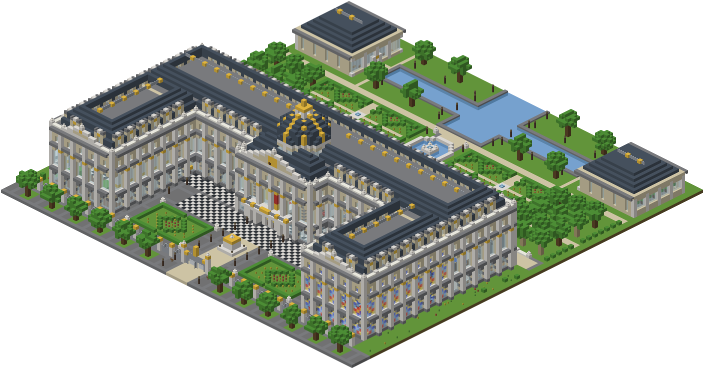

# Baroque palace

On the plains, at the end of an avenue lined with trees, a golden railing opens onto a huge court and a palace of marble and pale stone, with grey roofs, rows of tall windows and a dome. Behind it, a garden stretches out as far as a canal in the shape of a cross. It is the **Baroque palace**, and everything in it is **symmetric**: the left half is the mirror of the right one.

## What inspired it

It is inspired by **Versailles**, near Paris. It began as a small hunting lodge of King Louis XIII, and his son **Louis XIV**, the "Sun King", turned it into the greatest palace in Europe; in 1682 he moved the whole court there. It is not a copy, but it borrows its ideas:

- **Symmetry and order everywhere**: the palace, the court and the garden are laid out on one straight axis, from the avenue through the throne room to the canal. Baroque kings wanted to show that they ruled even over nature.
- **Three courts one inside another**: the *place d'armes* (the parade ground), the *cour d'honneur* (the court of honour) and the marble court in front of the main building.
- **Mansard roofs**: steep roofs of  slate with windows (dormers) in them, named after the architect François Mansart.
- The main floor is not the ground floor but the one above: the ***piano nobile***, the noble floor, where the king lived and received.

## A walk through it

**The approach.** An avenue of  limestone crosses the *place d'armes* between rows of clipped trees and lamps. At its end, the **golden railing**: iron bars between marble piers, with three iron gates on the axis under a gilded crest.

**The court of honour.** Between the two wings, lawns edged with box hedges, flowers, busts at their corners and, in the middle, an **equestrian monument** on a marble plinth. At the back, a portico of paired columns carries a balcony over the three main doors.

**The wings.** On the west, the **chapel**, three storeys tall: marble piers, stained glass windows, benches facing the altar and, over the door, the **royal tribune** with the organ. On the east, the **opera**: a stage framed in gold with red curtains, scenery and footlights, a pit of benches and the **royal box**.

**The cellars**, under each end of the palace: the **kitchens**, with a row of ovens under a brick hood, sinks, a long table and the larder; and the **cellar**, with rows of barrels and chests of stores.

**The ground floor.**

- The **vestibule**: a floor of marble squares, two rows of columns, busts between them and three chandeliers.
- The **garden salon**: sofas round a  fountain and orange trees in boxes.
- The two **grand staircases**, five blocks wide, of white tile, with a gilded balustrade round the opening and lanterns on marble posts.
- The **baths**: a bath hall for the court (a marble basin with a fountain, a bathtub, basins with mirrors) and, beside it, two small rooms: a **privy** with a basin and a **bathroom** with a bathtub; the **guard hall**, the **banquet hall** (one long table set with candles, the king's and queen's chairs at its head) and the **library** (bookshelves, reading desks and a globe).

**The noble floor.**

- The **throne room**, over the vestibule: a  gilded throne on a dais of two steps under a canopy of red and gold, a red carpet, banners and chandeliers. Over it rises the **dome**, with a lantern of glass and a gold finial.
- The **Hall of Mirrors**, the jewel of the palace, along the garden front: every arcade, facing a window, has in its middle a **tall mirror in a gilded frame** among white and gold panels, with gilded pilasters between the arcades, a row of chandeliers, candelabra and a parquet floor.
- At its ends, the **treasury** (chests of gold and gems, glass cases, gold on marble pedestals) and the **optics cabinet** (below).
- The **queen's apartment** and the **king's apartment**: each has a bedchamber with a state bed behind a gilded rail, a desk and curtains; behind it, a **closet** with the wardrobes and the dressing table with its mirror, and a small **washroom** with a bathtub, a basin and a toilet; and an antechamber with sofas, paintings and a clock. You can tell somebody lives there: a letter half written on the queen's desk, tea served in her antechamber, a game of chess half played in the king's.

**The attic**, under the roofs: the servants' rooms along a long corridor, their hall and the linen room. Two **service stairs**, one at each end, climb all the way from the cellars to the attic.

**The garden**, a French garden: a terrace with orange trees, the **water parterre** with two long basins, *parterres de broderie* (box hedges in patterns of diamonds with red and yellow flowers), the **Latona fountain** on a stepped island, an *allée* of busts down to the **grand canal**, shaped like a cross, and groves of trees on both sides. At the far end stand the **orangery**, with orange trees in boxes, and the **stables**.

## The science corner: the optics cabinet

At the east end of the Hall of Mirrors, through a gilded door, is a small room about **light**. It has three experiments, each with its sign:

**1. Reflection.** A lantern, a low wall of silver mirrors and a bust. Lines of carpet on the floor show the ray: yellow from the lantern to the mirror and from the mirror to the bust, and a white line square to the mirror, the **normal**. Light bounces off a mirror at the **same angle** at which it arrives: **angle in = angle out**, both measured from the normal. That is the law of reflection, and it is why a billiard ball bouncing off the cushion behaves the same way.

**2. Two mirrors face to face**, with candles between them. Each mirror sends the candlelight back, so the room looks twice as bright; and the two mirrors send the flame to each other again and again, so you see a row of flames that seems to go on for ever, each a little dimmer, because every bounce loses a little light. This was the trick of the real Hall of Mirrors: in 1684 there was no electric light, and its 357 mirrors **multiplied the light of thousands of candles**.

**3. White light into colours.** A glass prism stands by a clear window, and on the floor a **fan of seven colours** spreads out from it; the next window is of stained glass in the order of a rainbow. White light is a **mix of all colours**. Glass bends light as it goes in and out, and it bends each colour by a slightly different amount (violet the most, red the least), so they come out separated. Raindrops do the same with sunlight: that is a **rainbow**.

| Colour | Bends |
|---|---|
| Red | the least |
| Orange, yellow, green, light blue, blue | more and more |
| Violet | the most |

The cabinet also has a globe, an  astrolabe on a desk and a painting of the night sky.

> **Try it:** in the Hall of Mirrors, stand close to a mirror and look at yourself. A mirror in the game shows the world when you are near it; farther away it only shines (see [Mirrors](232)).

## What the chests hold

- **Kitchens and cellar:** bread, cheese, honey, salt, fish fresh, salted and frozen, ice, milk, cold water and soda water, wheat, coal and planks.
- **Optics cabinet:** telescopes, silver mirrors, glass, cobalt glass, star charts, a measuring tape and candles.
- **Library:** star charts, blueprints, breeding notebooks, a globe.
- **Treasury:** gold leaf, gold ore and gold blocks, rubies, sapphires, amber, fluorite, pyrite, brass and bronze ingots.
- **Guard hall and rooms:** torches, lanterns, leather, warm coats, wool and candles.
- **Orangery and stables:** saplings, fertilizer, seeds, honey, buckets of water, wheat, leather and a fishing rod.

## Curiosities

- The real Hall of Mirrors is **73 metres long**. In the 17th century mirrors were a great luxury, and the glassmakers of **Venice** kept the secret of making them. France brought some of them to Paris in secret to make its own.
- **Isaac Newton** split sunlight with a prism around 1666, and then put the colours back together into white with a second prism. He counted **seven** colours because he liked the idea of matching the seven notes of the musical scale; a real rainbow fades from one colour into the next.
- The **Latona fountain** of Versailles tells a Greek myth: peasants who insulted the goddess Latona were turned into frogs, and there are frogs and turtles of gilded lead all round it.
- Louis XIV often **dined in public**: courtiers and visitors came in to watch the king eat, standing, while he sat at his table.

The other palaces: [Andalusian palace](315), [Oriental palace](317), [Winter palace](318), [Maya palace](319) and [Volcanic palace](320); and the [Castle](307).

See also: [Mirrors](232), [Silver mirror](181), [Stained glass](229), [Light and darkness](105), [Lights without electricity](228), [Fine stones and metals](59), [Furniture](223), [Chairs and sofas](224), [Paintings, clock and ornaments](231), [Chests and wardrobes](226), [Telescope](133), [Astronomy](132).
