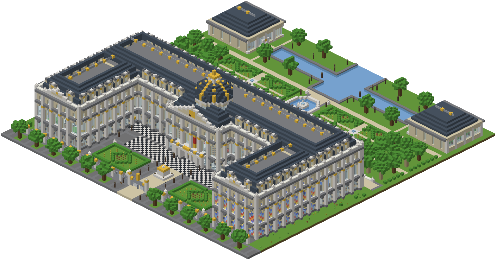

# Palacio barroco

En la llanura, al final de una avenida flanqueada de árboles, una verja dorada se abre a un patio enorme y a un palacio de mármol y piedra clara, con tejados grises, filas de ventanales y una cúpula. Detrás, un jardín se extiende hasta un canal en forma de cruz. Es el **Palacio barroco**, y en él todo es **simétrico**: la mitad izquierda es el reflejo de la derecha.

## En qué se inspira

Se inspira en **Versalles**, cerca de París. Empezó siendo un pequeño pabellón de caza del rey Luis XIII, y su hijo **Luis XIV**, el "Rey Sol", lo convirtió en el palacio más grande de Europa; en 1682 se llevó allí a toda la corte. No es una copia, pero toma sus ideas:

- **Simetría y orden por todas partes**: el palacio, el patio y el jardín siguen un solo eje recto, de la avenida al canal pasando por el salón del trono. Los reyes barrocos querían mostrar que mandaban hasta sobre la naturaleza.
- **Tres patios uno dentro de otro**: la *plaza de armas*, el *patio de honor* y el patio de mármol ante el edificio principal.
- **Mansardas**: tejados empinados de  pizarra con ventanas (buhardillas), que deben su nombre al arquitecto François Mansart.
- La planta principal no es la baja sino la de encima: la ***planta noble***, donde el rey vivía y recibía.

## Un paseo por dentro

**La llegada.** Una avenida de  caliza cruza la plaza de armas entre filas de árboles recortados y farolas. Al final, la **verja dorada**: barrotes de hierro entre pilares de mármol, con tres puertas de hierro en el eje bajo un escudo dorado.

**El patio de honor.** Entre las dos alas hay céspedes bordeados de boj, flores, bustos en las esquinas y, en el centro, un **monumento ecuestre** sobre un pedestal de mármol. Al fondo, un pórtico de columnas pareadas sostiene un balcón sobre las tres puertas principales.

**Las alas.** Al oeste, la **capilla**, de tres pisos de alto: pilares de mármol, vidrieras, bancos mirando al altar y, sobre la puerta, la **tribuna real** con el órgano. Al este, la **ópera**: un escenario con marco dorado, telones rojos, decorados y candilejas, un patio de butacas de bancos y el **palco real**.

**Los sótanos**, bajo cada extremo del palacio: las **cocinas**, con una fila de hornos bajo una campana de ladrillo, fregaderos, una mesa larga y la despensa; y la **bodega**, con filas de barriles y cofres de provisiones.

**La planta baja.**

- El **vestíbulo**: suelo de cuadros de mármol, dos filas de columnas, bustos entre ellas y tres lámparas de araña.
- El **salón del jardín**: sofás alrededor de una  fuente y naranjos en macetones.
- Las dos **escaleras de honor**, de cinco bloques de ancho, de azulejo blanco, con una balaustrada dorada alrededor del hueco y faroles sobre postes de mármol.
- Los **baños**: una sala de baños para la corte (un pilón de mármol con fuente, una bañera, lavabos con espejo) y, a su lado, dos cuartitos: un **retrete** con lavabo y un **cuarto de baño** con bañera; la **sala de guardias**, el **comedor de gala** (una mesa larguísima con velas y los sillones del rey y la reina en la cabecera) y la **biblioteca** (estanterías, mesas de lectura y un globo).

**La planta noble.**

- El **salón del trono**, sobre el vestíbulo: un  trono dorado sobre un estrado de dos escalones bajo un dosel rojo y oro, una alfombra roja, estandartes y lámparas de araña. Encima se alza la **cúpula**, con una linterna de vidrio y un remate de oro.
- La **Galería de los Espejos**, la joya del palacio, a lo largo de la fachada del jardín: cada arco, frente a una ventana, tiene en el centro un **espejo alto con marco dorado** entre paneles blancos y dorados, con pilastras doradas entre los arcos, una fila de lámparas de araña, candelabros y suelo de parqué.
- En sus extremos, el **tesoro** (cofres de oro y gemas, vitrinas, oro sobre pedestales de mármol) y el **gabinete de óptica** (más abajo).
- Los **aposentos de la reina** y los **del rey**: cada uno con un dormitorio con cama de aparato tras una barandilla dorada, un escritorio y cortinas; detrás, un **vestidor** con los armarios y el tocador con espejo, y un **aseo** pequeño con bañera, lavabo y retrete; y una antecámara con sofás, cuadros y un reloj. Se nota que alguien vive allí: una carta a medio escribir en el escritorio de la reina, el té servido en su antecámara, una partida de ajedrez a medias en la del rey.

**El desván**, bajo los tejados: los cuartos del servicio a lo largo de un pasillo largo, su comedor y la lencería. Dos **escaleras de servicio**, una en cada extremo, suben desde los sótanos hasta el desván.

**El jardín**, a la francesa: una terraza con naranjos, el **parterre de agua** con dos estanques largos, *parterres de bordado* (setos de boj en rombos con flores rojas y amarillas), la **fuente de Latona** sobre una isla escalonada, un paseo de bustos hasta el **gran canal**, en forma de cruz, y bosquetes de árboles a los lados. Al fondo están el **invernadero de naranjos** (la *orangerie*) y las **caballerizas**.

## El rincón de la ciencia: el gabinete de óptica

En el extremo este de la Galería de los Espejos, tras una puerta dorada, hay una salita dedicada a la **luz**. Tiene tres experimentos, cada uno con su cartel:

**1. La reflexión.** Un farol, un murete de espejos de plata y un busto. Unas líneas de alfombra en el suelo dibujan el rayo: amarilla del farol al espejo y del espejo al busto, y una línea blanca perpendicular al espejo, la **normal**. La luz rebota en un espejo con el **mismo ángulo** con que llega: **ángulo de entrada = ángulo de salida**, los dos medidos desde la normal. Es la ley de la reflexión, y por eso una bola de billar rebota en la banda de la misma manera.

**2. Dos espejos enfrentados**, con velas entre ellos. Cada espejo devuelve la luz de las velas, así que la sala parece el doble de luminosa; y los dos espejos se pasan la llama una y otra vez, así que ves una fila de llamas que parece no acabar nunca, cada una un poco más tenue, porque en cada rebote se pierde algo de luz. Ese era el truco de la Galería de los Espejos de verdad: en 1684 no había luz eléctrica, y sus 357 espejos **multiplicaban la luz de miles de velas**.

**3. La luz blanca se abre en colores.** Un prisma de vidrio está junto a una ventana transparente, y en el suelo se abre desde él un **abanico de siete colores**; la ventana de al lado es una vidriera con los colores del arcoíris en orden. La luz blanca es una **mezcla de todos los colores**. El vidrio tuerce la luz al entrar y al salir, y tuerce cada color un poco distinto (el violeta lo que más, el rojo lo que menos), así que salen separados. Las gotas de lluvia hacen lo mismo con la luz del sol: eso es el **arcoíris**.

| Color | Se tuerce |
|---|---|
| Rojo | lo que menos |
| Naranja, amarillo, verde, celeste, azul | cada vez más |
| Violeta | lo que más |

En el gabinete hay además un globo, un  astrolabio sobre un escritorio y un cuadro del cielo nocturno.

> **Pruébalo:** en la Galería de los Espejos, acércate a un espejo y mírate. En el juego, un espejo muestra el mundo cuando estás cerca; de lejos solo brilla (mira [Espejos](232)).

## Qué guardan los cofres

- **Cocinas y bodega:** pan, queso, miel, sal, pescado fresco, en salazón y congelado, hielo, leche, agua fría y con gas, trigo, carbón y tablones.
- **Gabinete de óptica:** telescopios, espejos de plata, vidrio, vidrio de cobalto, cartas estelares, una cinta métrica y velas.
- **Biblioteca:** cartas estelares, planos, cuadernos de cría y un globo.
- **Tesoro:** pan de oro, mineral de oro y bloques de oro, rubíes, zafiros, ámbar, fluorita, pirita, lingotes de latón y de bronce.
- **Sala de guardias y cuartos:** antorchas, faroles, cuero, abrigos, lana y velas.
- **Orangerie y caballerizas:** plantones, fertilizante, semillas, miel, cubos de agua, trigo, cuero y una caña de pescar.

## Curiosidades

- La Galería de los Espejos de verdad mide **73 metros**. En el siglo XVII los espejos eran un lujo enorme, y los vidrieros de **Venecia** guardaban el secreto de fabricarlos. Francia se llevó a algunos a París a escondidas para hacer los suyos.
- **Isaac Newton** abrió la luz del sol con un prisma hacia 1666, y luego volvió a juntar los colores en blanco con un segundo prisma. Contó **siete** colores porque le gustaba la idea de que coincidieran con las siete notas de la escala musical; en un arcoíris de verdad un color se funde con el siguiente.
- La **fuente de Latona** de Versalles cuenta un mito griego: unos campesinos que insultaron a la diosa Latona fueron convertidos en ranas, y alrededor de la fuente hay ranas y tortugas de plomo dorado.
- Luis XIV **comía muchas veces en público**: cortesanos y visitantes entraban a mirar, de pie, cómo comía el rey sentado a su mesa.

Los otros palacios: [Palacio andalusí](315), [Palacio oriental](317), [Palacio de invierno](318), [Palacio maya](319) y [Palacio volcánico](320); y el [Castillo](307).

Ver también: [Espejos](232), [Espejo de plata](181), [Vidrieras](229), [Luz y oscuridad](105), [Luces sin electricidad](228), [Piedras nobles y metales](59), [Índice de muebles](223), [Sillas y sofás](224), [Cuadros, reloj y adornos](231), [Cofres y armarios](226), [Telescopio](133), [Astronomía](132).
