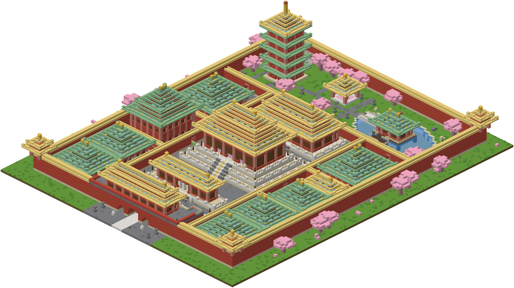

# Oriental palace

In a forest of cherry trees rises a long red wall with a gate tower and a watch pavilion on each corner. Over the wall you can see roofs of **yellow and green glazed tiles** whose eaves **curl up** at the corners. A sign at the entrance gives its name: the **Cherry Blossom Palace**.

## What inspired it

It is inspired by the **Forbidden City** of Beijing, the palace of the emperors of China, built between 1406 and 1420 and lived in by 24 emperors until 1912. It was called "forbidden" because nobody could go in or out without the emperor's permission. This palace has a plan of its own, but it follows the same ideas:

- **One straight axis**, from south to north in Beijing, along which courts and halls follow one another. Each hall is **bigger and higher** than the one before, on **white terraces** of stone, so that the way to the emperor feels like a climb.
- **Yellow** roof tiles were for the emperor only; the other buildings have **green** ones. Here too: yellow for the halls of the axis, green for the rest.
- Wooden halls with **red lacquered columns**, lattice screens between them, a band of blue and green brackets under the eaves, a coffered ceiling inside and **gold beasts** at the ends of the ridges.
- At the back, behind everything, a **garden** for the emperor's rest.

## A walk through it

**The gate tower.** It has three ways through: the arched one in the middle was the **emperor's**, and the two at the sides for everybody else. Beside them are guard rooms, and a ramp climbs to the **watch hall** on top, with a council table, banners, a drum and the watchman's chests.

**The outer court.** A **golden stream** crosses it between stone balustrades, with **three bridges**. Beyond it stands the **Gate of Harmony**, a hall on a terrace open through the middle, guarded by lions.

**The Hall of Supreme Harmony.** In the great court, on **three terraces** one over another, stands the most important hall: the coronations, the New Year and the emperor's birthday were celebrated in its real model. Up the middle of each stair runs the **dragon way**, a slope of carved stone: the emperor was carried over it in his chair and nobody stepped on it. Bronze cranes and incense burners (here, lanterns on posts) stand on the terraces. Inside: columns topped in gold, yellow and red banners, chandeliers from the coffered ceiling and, on a dais of two marble steps, the  **red lacquer throne** in front of a gold screen. Its roof has **two tiers**, as only the grandest halls did.

**The Palace of Heavenly Purity.** Behind it: the **audience hall** in front, with the  jade throne and the ministers' benches; and behind a wall of screens, the emperor's rooms: the bedchamber, the study with his maps, and the bath.

**The side courts**, behind red walls on either side of the axis:

- **West:** the **imperial kitchen** (ovens on a brick hearth, chopping tables, barrels), the **banquet hall** with long low tables, a well, the **granary** and the **imperial treasury**, the **ancestral shrine** (an altar with candles and incense and red banners, to honour the family's grandparents) and the **west residence**, with a sitting room, a zither on a table and bedrooms behind  paper screens.
- **East:** the **servants' quarters**, the **stables**, the **library pavilion** of two floors (shelves everywhere, desks, a globe and an astrolabe) and the **east residence** of the prince, with a music room, a bedroom, a dressing room and a small bath behind it.

**The imperial garden.** Through a round **moon gate** you enter the garden: a **pond** with the **koi pavilion** standing on it, a **zigzag bridge** and an **arched bridge**, rockeries, cherry trees, **stone lanterns**, a **tea pavilion**, a **five-storey pagoda** (a lookout with a telescope waits at the top) and a **greenhouse** with an orchard of cherries beside it.

## The science corner: the koi pavilion and the greenhouse

The koi pavilion stands on posts over the pond. In the middle of its floor there is a **window of glass**, and under it the water is deeper: from there you can watch what swims below. Along the back wall are the **breeders'** chests and their record table, with three signs:

- **Each koi gets genes from its mother and from its father.** Genes decide its colours, and that is why the young look like their parents.
- **Breeders choose which koi have young.** Crossing fish with rare colours, generation after generation, new colours appear.
- In MineCloud you can breed animals and see their genes too: with the [breeding notebook](131) and the [Genetics](130) topic.

**Where koi come from.** Koi are **carp**, a plain grey-brown fish that people in China and Japan raised for food in ponds and rice fields. In the early 1800s, rice farmers in Niigata, in Japan, noticed that now and then a carp was born with red or white patches. They kept those, and **let only the most colourful ones have young**. After two hundred years of doing that, there are more than a hundred varieties of koi: the *kohaku* is white with red patches, the *ogon* all gold. This is **selective breeding**: people do not create colours, they choose the parents, and the genes do the rest. Even today, out of thousands of baby koi, a breeder keeps only a few.

> In the game, **koi** are one of the four kinds of [fish](26): white with orange patches. The chests of the pavilion hold fish eggs, rods and a bug net.

**The greenhouse**, in a corner of the garden, has walls and roof of glass, beds of red and yellow flowers, saplings in pots and the gardener's chest. Its sign explains how **new plants** are bred: the gardener carries **pollen** from one flower to another, and the seeds get **genes from both plants**. That is how, in the 1850s and 1860s, the monk **Gregor Mendel** discovered the laws of inheritance: crossing pea plants in his monastery garden and counting their peas, smooth and wrinkled, yellow and green.

| | Koi | Plants |
|---|---|---|
| Who chooses the parents | the breeder | the gardener |
| How the parents meet | in the pond | pollen carried from flower to flower |
| What the young inherit | genes from mother and father | genes from both plants |

## What the chests hold

- **Kitchen, banquet hall and granary:** bread, cheese, honey, cooked fish, soda water, wheat, seeds, fertilizer and saplings.
- **Treasuries:** gold leaf, gold ore, rubies, sapphires, bronze and brass ingots, amber, glazed tiles and cobalt glass.
- **Watch hall, library and pagoda:** telescopes, star charts, a barometer, a thermometer and an anemometer, an astrolabe, a globe, a sundial, blueprints and breeding notebooks.
- **Koi pavilion:** fish eggs, raw fish, fishing rods, a bug net, buckets, breeding notebooks and a thermometer.
- **Residences:** wool of many colours, furs, warm coats, feathers and candles.
- **Greenhouse:** cherry saplings, wheat seeds, fertilizer, a hoe and a bucket of water.

## Curiosities

- The Forbidden City has almost **a thousand buildings**. A legend says it has 9,999 rooms, one fewer than the palace of the gods in heaven.
- The real dragon way behind the Hall of Preserving Harmony is a single carved stone of about **200 tonnes**. It was dragged there in winter over a road of ice, which workers kept wet with water from wells.
- The beasts on the corners of the roofs say how important a hall is: the more beasts, the higher its rank. The Hall of Supreme Harmony is the only one with ten.
- Japanese **five-storey pagodas** of wood have stood through earthquakes for more than a thousand years: their floors are not fixed rigidly to one another, and the building sways like a snake instead of breaking.
- **Goldfish** are the koi's Chinese cousins: they were bred from a dull carp in China more than a thousand years ago.

The other palaces: [Andalusian palace](315), [Baroque palace](316), [Winter palace](318), [Maya palace](319) and [Volcanic palace](320); and the [Castle](307).

See also: [Genetics](130), [Breeding notebook](131), [Fish](26), [Fishing](6), [Taming and breeding](3), [Saplings](55), [Flowers and mushrooms](61), [Bricks](57), [Windows](198), [Furniture](223), [Lights without electricity](228), [Chests and wardrobes](226).
