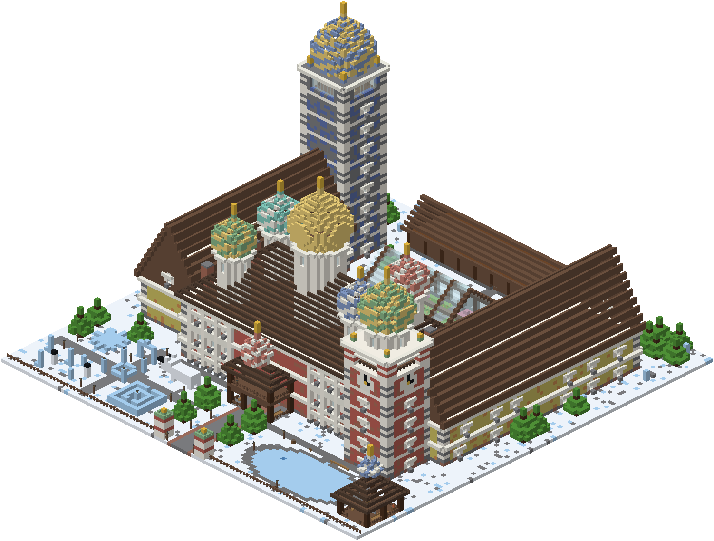

# Winter palace

Among snowy spruce trees, beyond a frozen pond and a garden of ice, stands a palace of **red brick** trimmed in white, with steep dark roofs and a cluster of **striped onion domes** round a golden one. Inside, there is a fire in nearly every room. A sign at the gate gives its name: the **Winter Palace of the Aurora**.

## What inspired it

It takes its ideas from the buildings of **Russia** and the **Nordic** countries, where winter is long and dark. It is not a copy of any one of them:

- The **onion domes**, striped and brightly coloured, recall those of **Saint Basil's Cathedral** in Moscow (1555–1561). Some people say their shape keeps snow from piling up on top.
- The **red brick with white stucco trim** recalls the Moscow Kremlin, and its carved **wooden porches and galleries**, the wooden palace that Tsar Alexis built at Kolomenskoye in the 1660s.
- The **banya**, the Russian steam bath, is a cousin of the Finnish sauna.
- Its name borrows that of the Winter Palace of Saint Petersburg, the tsars' home, though that one looks quite different: green and white, by a river.

## A walk through it

**The gate and the avenue.** Two white pillars banded in red, each under a little green tent with a gold knob, open onto an avenue straight to the porch.

**The frozen pond**, on one side of the avenue: a sheet of  packed ice for skating, with water under it and a **hole for ice fishing**. On its shore, benches, lamps and a **warming hut** of logs with a brazier in the middle, warm coats and fishing rods.

**The ice garden**, on the other side: a frozen fountain on a round plaza, four obelisks of ice with a light on each, a **maze** of ice walls with a crystal at its heart, ice spikes, snowmen in black hats, a **bear** made of snow, an arch of ice and a giant **snowflake** laid out on the ground.

**The main block**, on a plinth of granite, with three floors and an attic:

- **Ground floor:** the vestibule with the **grand stair**; the **cloakroom**, where coats and furs wait, with benches to pull on your boots and a mirror; the **treasury**, behind an iron door and barred windows; and the **great hall** at the back.
- **First floor:** the **library** (shelves, a reading table, a desk with a lamp, the globe), the **weather room** (the science corner) and, at the back, the **throne room**, two floors high: a  gilded throne on a dais of two steps with a gold frame behind it, columns of spruce with white capitals and rugs of white fur.
- **Second floor:** the **royal bedroom**, with a small washroom of its own and tea set out by the fire, and the east suite: a little salon with a game of chess left half played, a study, a bedroom, a dressing closet and a washroom. From the landing, windows look down into the throne room. A **balcony** with a carved rail stands over the porch.

**The west wing**, of ochre brick: the **kitchen** with a great cooking hearth and three ovens, the **cold store** (its walls lined with snow and ice, barrels of salted fish and frozen food), the servants' hall and the **laundry**. Upstairs, the servants' rooms, a sewing room, the servants' privy, a store of firewood and candles, the housekeeper's room and the linen store.

**The east wing:** the **Hall of Light**, two floors high, for music and quiet (rows of benches facing a marble bust, stained glass, candles and chandeliers); the storeroom of metal and leather; the **sleigh workshop**, with a sleigh of spruce on its runners. Upstairs, the children's bedroom and the guest bedroom, each with a little washroom.

**Two towers.** In front of the west wing, the **bell tower**, with clock faces, a belfry with its bells and a green dome. Behind the east wing, the **observatory tower**, the tallest of the palace, nine storeys up to a room with windows all round.

**The courtyard**, behind the main block: a wooden gallery, a  sundial, the **orangery** of glass full of flowers, little trees and cacti, and the **banya**: a log house with a changing room, a **steam room** with a stove of hot stones and two tiers of benches, and a **cold plunge pool** with blocks of ice in its corners. Beyond it, the **stables** with their tack room.

The palace looks lived in: a meal half eaten in the kitchen, plates and jugs left on the tables, an open book in the library, a letter half written on a desk, some curtains drawn and others open.

Every fire in the palace is safe: glowing  magma rock behind iron bars, in a hearth of stone.

## The science corner: the physics of cold, and the sky

**The weather room** has the instruments in their chests, a desk with a logbook, the globe, a clock, a thermometer drawn on the wall (a glass column, red inside) and four signs:

| Sign | What it says |
|---|---|
|  [Thermometer](113) | The liquid inside **expands** when warm and climbs the tube; when cold it shrinks and goes down. |
|  [Barometer](114) | It measures the **weight of the air** above us. When the pressure falls, bad weather often comes. |
|  [Anemometer](114) | Its cups spin in the wind: the faster they turn, the stronger it blows. |
|  Snow | **Snow keeps things warm.** |

**Snow keeps things warm.** That sounds odd, but fresh snow is up to **nine parts air** to one of ice, and still air hardly lets heat through: it is the same trick as a wool jumper or a down jacket. That is why an **igloo** stays near freezing inside, warmed only by the people in it, while it is −40 °C outside, and why mice, voles and plants spend the winter under the snow, where it never gets much colder than 0 °C.

**Ice floats.** By the hole in the pond, a sign explains it. When water freezes, its molecules lock into crystals with **gaps** between them, so ice takes about **a tenth more room** than the water it came from. Being lighter than the same amount of water, it floats, with about nine tenths under the surface (like an iceberg). So lakes freeze **from the top down**, and the ice is a lid that keeps the water below liquid: the fish spend the winter swimming beneath it.

> **Look at the snowflake** in the ice garden: real snowflakes always have **six** arms, because ice crystals are built in hexagons. On a grid of square blocks the game can only do its best.

**The observatory**, at the top of its tower, has a telescope on its stand by the window, more telescopes and star charts in its chests, an astrolabe, a globe and a desk, and two signs:

- **Telescope:** it gathers far more light than your eye, so it shows faint stars and the craters of the Moon. With one of the first telescopes, in 1609 and 1610, Galileo saw mountains on the Moon and four moons going round Jupiter.
- **Aurora:** the Sun is always sending out a wind of tiny particles. Earth's magnetism steers them towards the poles, and when they hit the air 100 to 300 kilometres up, it **glows**: green and red from oxygen, blue and violet from nitrogen. In the north they are called the **northern lights**, and they are best seen in long winter nights in Lapland, Norway, Iceland or Canada.

The **orangery** has its sign too: glass lets sunlight in and keeps the warm air inside, so plants grow there while it freezes outside.

## What the chests hold

- **Kitchen, cold store and great hall:** bread, cheese, honey, salt, cooked and salted fish, ice, frozen bread and fish, cold milk and water, snow and packed ice.
- **Weather room:** thermometers, barometers, anemometers, a measuring tape, water flasks, glass, snow and ice, a sundial and star charts.
- **Observatory and library:** telescopes, star charts, an astrolabe, a globe, meteoric iron, blueprints and breeding notebooks.
- **Cloakroom and warming hut:** warm coats, furs, wool, leather and fishing rods.
- **Treasury and storeroom:** gold, rubies, sapphires, amber, meteoric iron, ingots of brass and bronze, blocks of iron and copper, copper wire and a wrench.
- **Orangery, stables and workshop:** saplings, fertilizer, seeds, wheat, leather, buckets and planks.

## Curiosities

- In a Russian **banya**, after the steam room (60 to 90 °C) people jump into cold water or roll in the snow. Some also beat themselves gently with bunches of birch twigs.
- Water is at its **heaviest at 4 °C**. In winter that water sinks to the bottom of a lake, and the fish wait there.
- An American farmer, **Wilson Bentley**, photographed more than 5,000 snowflakes from 1885 on, and never found two the same.
- The aurora also shines round the South Pole: the **southern lights**. From space, astronauts see it as a ring of light round the pole.

The other palaces: [Andalusian palace](315), [Baroque palace](316), [Oriental palace](317), [Maya palace](319) and [Volcanic palace](320); and the [Castle](307).

See also: [Water](52), [Weather station](112), [Thermometer](113), [Barometer and anemometer](114), [Day, night and weather](8), [Telescope](133), [Astronomy](132), [Star chart](134), [Bricks](57), [Warm coat](90), [Fur](77), [Fishing](6), [Lights without electricity](228), [Stained glass](229).
