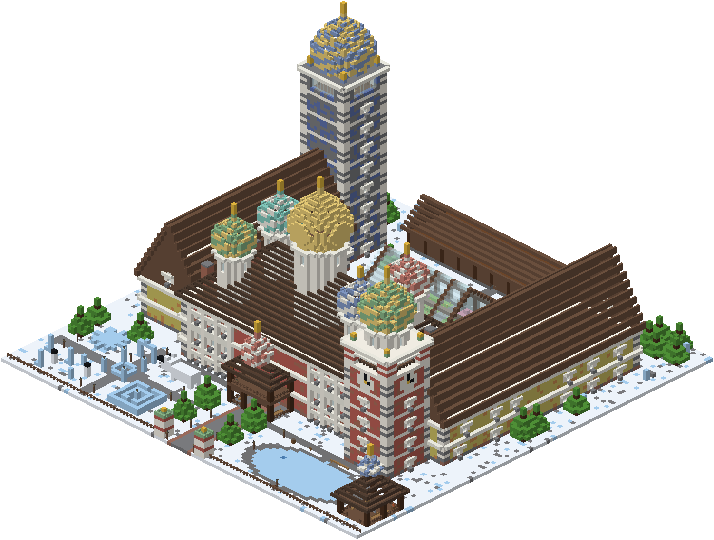

# Palacio de invierno

Entre abetos nevados, más allá de un estanque helado y de un jardín de hielo, se alza un palacio de **ladrillo rojo** con molduras blancas, tejados oscuros muy empinados y un racimo de **cúpulas de cebolla a rayas** alrededor de una dorada. Dentro hay un fuego en casi cada sala. Un cartel en la verja dice su nombre: el **Palacio de Invierno de la Aurora**.

## En qué se inspira

Toma sus ideas de los edificios de **Rusia** y de los países **nórdicos**, donde el invierno es largo y oscuro. No copia ninguno en concreto:

- Las **cúpulas de cebolla**, a rayas y de colores vivos, recuerdan a las de la **catedral de San Basilio** de Moscú (1555-1561). Hay quien dice que su forma impide que la nieve se amontone encima.
- El **ladrillo rojo con molduras de estuco blanco** recuerda al Kremlin de Moscú, y sus **porches y galerías de madera tallada**, al palacio de madera que el zar Alejo mandó construir en Kolómenskoye hacia 1660.
- La **banya**, el baño de vapor ruso, es prima de la sauna finlandesa.
- Su nombre toma prestado el del Palacio de Invierno de San Petersburgo, la casa de los zares, aunque aquel es muy distinto: verde y blanco, junto a un río.

## Un paseo por dentro

**La verja y la avenida.** Dos pilares blancos con franjas rojas, cada uno bajo una tiendecita verde con una bola dorada, dan paso a una avenida que va derecha hasta el porche.

**El estanque helado**, a un lado de la avenida: una lámina de  hielo compacto para patinar, con agua debajo y un **agujero para pescar en el hielo**. En la orilla hay bancos, faroles y una **caseta de troncos** para calentarse, con un brasero en el centro, abrigos y cañas de pescar.

**El jardín de hielo**, al otro lado: una fuente helada en una plazoleta redonda, cuatro obeliscos de hielo con una luz cada uno, un **laberinto** de muros de hielo con un cristal en el centro, agujas de hielo, muñecos de nieve con sombrero negro, un **oso** hecho de nieve, un arco de hielo y un **copo de nieve** gigante dibujado en el suelo.

**El edificio principal**, sobre un zócalo de granito, con tres plantas y un desván:

- **Planta baja:** el vestíbulo con la **escalera de honor**; el **guardarropa**, donde esperan abrigos y pieles, con bancos para ponerse las botas y un espejo; el **tesoro**, tras una puerta de hierro y ventanas con rejas; y el **gran salón** al fondo.
- **Primera planta:** la **biblioteca** (estanterías, una mesa de lectura, un escritorio con lámpara, el globo), la **sala del tiempo** (el rincón de la ciencia) y, al fondo, el **salón del trono**, de dos plantas de alto: un  trono dorado sobre un estrado de dos escalones con un marco de oro detrás, columnas de abeto con capiteles blancos y alfombras de piel blanca.
- **Segunda planta:** el **dormitorio real**, con un pequeño baño propio y un juego de té junto al fuego, y las habitaciones del este: un saloncito con una partida de ajedrez a medias, un despacho, un dormitorio, un vestidor y un baño. Desde el rellano, unas ventanas se asoman al salón del trono. Sobre el porche hay un **balcón** con barandilla tallada.

**El ala oeste**, de ladrillo ocre: la **cocina**, con un gran hogar y tres hornos; la **despensa fría** (paredes forradas de nieve y hielo, barriles de pescado en salazón y comida congelada); el comedor del servicio y la **lavandería**. Arriba, los cuartos del servicio, un cuarto de costura, el aseo del servicio, un almacén de leña y velas, el cuarto del ama de llaves y el almacén de ropa blanca.

**El ala este:** la **Sala de la Luz**, de dos plantas de alto, para la música y el silencio (filas de bancos ante un busto de mármol, vidrieras, velas y lámparas de araña); el almacén de metal y cuero; el **taller del trineo**, con un trineo de abeto sobre sus patines. Arriba, el dormitorio de los niños y el de invitados, cada uno con un pequeño baño.

**Dos torres.** Delante del ala oeste, el **campanario**, con esferas de reloj, un cuerpo de campanas y una cúpula verde. Detrás del ala este, la **torre del observatorio**, la más alta del palacio: nueve pisos hasta una sala con ventanales por todos lados.

**El patio**, detrás del edificio principal: una galería de madera, un  reloj de sol, el **invernadero de naranjos**, de vidrio, lleno de flores, arbolitos y cactus, y la **banya**: una casa de troncos con vestuario, un **cuarto de vapor** con una estufa de piedras calientes y dos gradas de bancos, y una **piscina fría** con bloques de hielo en las esquinas. Más allá, las **caballerizas** con su guarnicionería.

El palacio parece habitado: una comida a medias en la cocina, platos y jarras olvidados en las mesas, un libro abierto en la biblioteca, una carta a medio escribir en un escritorio, unas cortinas corridas y otras abiertas.

Todos los fuegos del palacio son seguros:  roca de magma encendida tras barrotes de hierro, en un hogar de piedra.

## El rincón de la ciencia: la física del frío, y el cielo

**La sala del tiempo** tiene los instrumentos en sus cofres, un escritorio con un cuaderno de registro, el globo, un reloj, un termómetro dibujado en la pared (una columna de vidrio, roja por dentro) y cuatro carteles:

| Cartel | Qué dice |
|---|---|
|  [Termómetro](113) | El líquido de dentro **se dilata** con el calor y sube por el tubo; con el frío se encoge y baja. |
|  [Barómetro](114) | Mide el **peso del aire** que tenemos encima. Si la presión baja, suele llegar mal tiempo. |
|  [Anemómetro](114) | Sus cazoletas giran con el viento: cuanto más deprisa, más fuerte sopla. |
|  Nieve | **La nieve abriga.** |

**La nieve abriga.** Parece raro, pero la nieve recién caída tiene hasta **nueve partes de aire** por una de hielo, y el aire quieto apenas deja pasar el calor: es el mismo truco que un jersey de lana o un plumífero. Por eso un **iglú** se queda cerca de cero grados por dentro, calentado solo por la gente que hay en él, mientras fuera hace −40 °C; y por eso ratones, topillos y plantas pasan el invierno bajo la nieve, donde casi nunca hace mucho menos de 0 °C.

**El hielo flota.** Junto al agujero del estanque, un cartel lo explica. Cuando el agua se hiela, sus moléculas se ordenan en cristales con **huecos**, así que el hielo ocupa más o menos **una décima parte más** que el agua de la que salió. Como pesa menos que la misma cantidad de agua, flota, con unas nueve décimas bajo la superficie (como un iceberg). Por eso los lagos se hielan **de arriba abajo**, y el hielo hace de tapa que mantiene líquida el agua de debajo: los peces pasan el invierno nadando bajo ella.

> **Fíjate en el copo de nieve** del jardín de hielo: los copos de verdad siempre tienen **seis** brazos, porque los cristales de hielo se forman en hexágonos. En una cuadrícula de bloques cuadrados, el juego hace lo que puede.

**El observatorio**, en lo alto de su torre, tiene un telescopio sobre su soporte junto a la ventana, más telescopios y cartas estelares en sus cofres, un astrolabio, un globo y un escritorio, y dos carteles:

- **Telescopio:** reúne mucha más luz que tu ojo, así que enseña estrellas débiles y los cráteres de la Luna. Con uno de los primeros telescopios, en 1609 y 1610, Galileo vio montañas en la Luna y cuatro lunas dando vueltas a Júpiter.
- **Aurora:** el Sol suelta sin parar un viento de partículas diminutas. El magnetismo de la Tierra las desvía hacia los polos, y cuando chocan con el aire a 100 o 300 kilómetros de altura, este **brilla**: verde y rojo por el oxígeno, azul y violeta por el nitrógeno. En el norte se llama **aurora boreal**, y se ve mejor en las largas noches de invierno de Laponia, Noruega, Islandia o Canadá.

El **invernadero** también tiene su cartel: el vidrio deja entrar la luz del sol y guarda dentro el aire caliente, así que las plantas crecen mientras fuera todo se hiela.

## Qué guardan los cofres

- **Cocina, despensa fría y gran salón:** pan, queso, miel, sal, pescado cocinado y en salazón, hielo, pan y pescado congelados, leche y agua frías, nieve y hielo compacto.
- **Sala del tiempo:** termómetros, barómetros, anemómetros, una cinta métrica, cantimploras, vidrio, nieve y hielo, un reloj de sol y cartas estelares.
- **Observatorio y biblioteca:** telescopios, cartas estelares, un astrolabio, un globo, hierro meteórico, planos y cuadernos de cría.
- **Guardarropa y caseta del estanque:** abrigos, pieles, lana, cuero y cañas de pescar.
- **Tesoro y almacén:** oro, rubíes, zafiros, ámbar, hierro meteórico, lingotes de latón y de bronce, bloques de hierro y de cobre, cable de cobre y una llave inglesa.
- **Invernadero, caballerizas y taller:** plantones, fertilizante, semillas, trigo, cuero, cubos y tablones.

## Curiosidades

- En una **banya** rusa, después del cuarto de vapor (de 60 a 90 °C) la gente se tira al agua fría o se revuelca en la nieve. Algunos además se dan golpecitos con ramilletes de abedul.
- El agua **pesa más a 4 °C**. En invierno esa agua se va al fondo del lago, y los peces esperan allí.
- Un granjero estadounidense, **Wilson Bentley**, fotografió más de 5.000 copos de nieve desde 1885, y nunca encontró dos iguales.
- La aurora también brilla alrededor del Polo Sur: la **aurora austral**. Desde el espacio, los astronautas la ven como un anillo de luz alrededor del polo.

Los otros palacios: [Palacio andalusí](315), [Palacio barroco](316), [Palacio oriental](317), [Palacio maya](319) y [Palacio volcánico](320); y el [Castillo](307).

Ver también: [Agua](52), [Estación meteorológica](112), [Termómetro](113), [Barómetro y anemómetro](114), [Día, noche y clima](8), [Telescopio](133), [Astronomía](132), [Carta estelar](134), [Ladrillos](57), [Abrigo cálido](90), [Pelo](77), [Pescar](6), [Luces sin electricidad](228), [Vidrieras](229).
