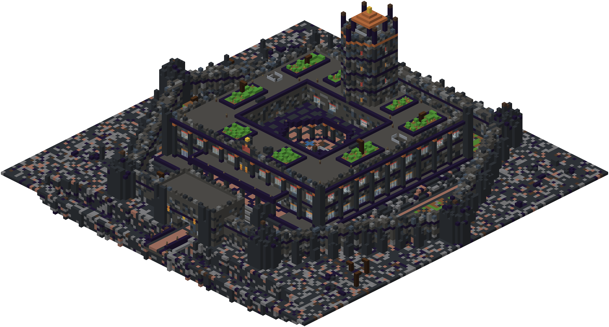

# Palacio volcánico

En una tierra de roca negra, ceniza y troncos carbonizados, una grieta del suelo brilla anaranjada en el fondo. Un puente la cruza hasta una puerta fortificada, y más allá una muralla de seis lados erizada de **columnas de basalto** rodea una ciudadela oscura que trepa por un peñasco, coronada por una torre con pináculos. Un cartel junto al puente dice su nombre: el **Palacio del Volcán**: basalto, obsidiana y roca de magma, y dentro, la **sala de los minerales**.

## En qué se inspira

Este palacio no imita a ninguno real: es una fantasía, construida con lo que da un volcán. Pero sus rocas y sus formas son de verdad:

- Su muralla y sus torres son haces de **columnas de basalto**, como las de la **Calzada del Gigante** en Irlanda del Norte, la **cueva de Fingal** en Escocia o **Los Órganos** de La Gomera, en Canarias. La lava que se enfría despacio se agrieta en columnas, casi todas de **seis caras**.
- Está hecho de  **basalto**,  **obsidiana**,  ladrillo oscuro y  pizarra, con  **roca de magma** brillando en canales, hogares y estanques.
- Sus **aguas termales** recuerdan a las de Islandia, Japón o Yellowstone, donde el calor de la Tierra calienta el agua que sube desde abajo.

## Un paseo por dentro

**La sima y el puente.** Por delante corre una sima de seis bloques de hondo, con roca de magma encendida en el fondo. Un puente de basalto con un camino de  granito y pretiles bajos de obsidiana la cruza hasta la **puerta fortificada**: un paso bajo un rastrillo levantado, un **cuerpo de guardia** a cada lado y la sala de la puerta encima.

**La muralla** es un **hexágono**. Haces de columnas de basalto de distintas alturas la sujetan como contrafuertes y forman **baluartes** en sus seis esquinas, con un remate encendido en la más alta de cada uno.

**El recinto**, dentro de la muralla: empedrado delante y, detrás, un jardín de plantas que crecen sobre la ceniza (musgo, arbustos, hierba, troncos carbonizados), una grieta que brilla, una **fuente termal** con columnas para sentarse y peñascos de roca áspera alrededor de la base sobre la que se alza el palacio.

**El palacio**, sobre un podio de cuatro bloques de alto. Subiendo la escalinata, entre haces de columnas, un pórtico de seis columnas lleva bajo un frontón escalonado con un **rosetón de vidrio rojo**.

- **Planta baja, delante:** el **gran salón** (dos mesas largas, una alfombra roja, **canales de magma** a lo largo de las paredes, lámparas de araña y estandartes); la **cocina**, con cuatro hornos bajo una campana y un **pozo de magma** para asar; y el **comedor**, con una mesa para diez.
- **Ala oeste:** los **baños termales** (dos piscinas en un marco de roca caliente, bancos, toallas) y la **sala de los minerales** (más abajo).
- **Ala este:** el **tesoro**, con el escritorio del guardián y, tras una puerta de hierro, su cámara acorazada; y la **fragua y fundición**: un hogar de magma bajo su campana, dos fundiciones, un horno, yunques de hierro, una pila para enfriar el metal y barriles de mineral.
- **Al fondo, en el eje:** el **salón del trono**, de dos plantas de alto. Un  trono de obsidiana se alza sobre un estrado de baldosa roja, y detrás suben columnas como los tubos de un órgano, más altas en el centro, encendidas y doradas en la punta.
- **El patio del cráter**, en medio de las cuatro alas: un patio hexagonal alrededor de un **estanque hundido de magma** tras barrotes de hierro, con un tapón de columnas de basalto que sale de él, dos **fuentes termales** y una columnata cuyo techo es una terraza de la primera planta.

**Primera planta:** el cuarto del servicio, la **biblioteca** (estanterías en todas las paredes, una mesa larga de lectura, un globo y un astrolabio), la suite de invitados (dormitorio, vestidor, antesala y baño), y un pasillo en cada ala con dormitorios y un estudio. Los dormitorios grandes tienen detrás un baño pequeño (bañera, lavabo y retrete) y un armario ropero, y el servicio tiene el suyo. Por las mesas quedan cosas de la vida diaria: platos a medio comer, libros abiertos, una carta a medio escribir, una partida de ajedrez; unas cortinas están corridas y otras abiertas.

**La azotea:** terrazas alrededor, con parterres de tierra de ceniza, plantas resistentes, troncos carbonizados y asientos hechos de columnas.

**La torre del homenaje**, una torre de seis lados sobre el tejado del salón del trono. Una escalera sube enroscada alrededor de un pilar, pasando por la antecámara, el **dormitorio real**, el **observatorio** y la sala de guardia, hasta una plataforma con una **corona de pináculos**: el punto más alto del palacio.

## El rincón de la ciencia: la sala de los minerales

Su suelo está empedrado de **hexágonos** de granito bordeados de obsidiana, como las caras de arriba de las columnas de basalto. En una pared hay **catorce vitrinas**, cada una con una roca o una mena sobre un pedestal de obsidiana y su etiqueta; en otra, siete vitrinas de **elementos**; en la tercera, las lecciones.

### Las tres familias de rocas

Todas las rocas de la Tierra pertenecen a una de tres familias, según **cómo nacieron**:

| Familia | Cómo nace | En las vitrinas |
|---|---|---|
| **Ígneas** | lava o magma que se enfrió y se endureció |  basalto,  granito,  obsidiana,  roca de magma |
| **Sedimentarias** | arena, barro y conchas que se depositaron en capas y se volvieron roca con el peso de las de arriba |  caliza,  arenisca, carbón (y la arena, que con el tiempo será arenisca) |
| **Metamórficas** | una roca cambiada por el calor y la presión, **sin fundirse** |  mármol (antes caliza),  pizarra (antes barro) |

**¿Deprisa o despacio?** Las rocas ígneas cuentan lo deprisa que se enfriaron. El granito se enfrió **despacio**, muy hondo, y sus cristales tuvieron tiempo de crecer hasta verse a simple vista. El basalto se enfrió **deprisa**, en la superficie, y su grano es finísimo. La obsidiana se enfrió **tan deprisa** que no llegó a formar cristales: es un **vidrio** natural.

Las tres familias están unidas en el **ciclo de las rocas**: una roca puede desgastarse hasta ser arena, apretarse en una roca nueva, cocerse en otra, fundirse en magma y volver a nacer, a lo largo de millones de años.

> **¿Qué es un fósil?** Un ser vivo enterrado en barro. En millones de años, los minerales lo vuelven piedra. Por eso los fósiles aparecen en rocas **sedimentarias**: la lava los habría quemado.

### Columnas de basalto

En una esquina hay una **maqueta de columnas de basalto**. Cuando una capa gruesa de lava se enfría, **encoge** y se agrieta, como el barro al secarse al sol. Las grietas se juntan formando **prismas de seis caras**: el hexágono es la forma que reparte una superficie en trozos iguales con las grietas más cortas. La Calzada del Gigante tiene unas **40.000**, de una lava que se enfrió hace unos 60 millones de años.

### Menas y elementos

Las otras vitrinas enseñan las **menas**, rocas con metal dentro: hierro, cobre, estaño y oro. "El oro casi no se mezcla con nada", dice su etiqueta, "así que está en la roca como metal puro." El estaño y el cobre juntos dan el bronce. Otras siete vitrinas guardan bloques de los **elementos** de los que están hechas las rocas:

| | Elemento | Su etiqueta dice |
|---|---|---|
|  | Silicio | con el oxígeno forma casi todas las rocas de la corteza |
|  | Hierro | el metal de la mena de hierro, y del centro de la Tierra |
|  | Cobre | el metal de la mena de cobre |
|  | Estaño | el metal de la mena de estaño |
|  | Oro | el metal que ya está puro en la roca |
|  | Plata | otro metal precioso de las menas |
|  | Azufre | sale amarillo por las grietas de los volcanes y huele a huevo podrido |

Hay también tres **cofres de muestras**, cada uno con su etiqueta en la tapa: uno de  pirita ("el oro de los tontos", hierro y azufre),  fluorita y  hierro de un meteorito; otro de **fósiles**, trilobites y amonites de los mares antiguos, y  ámbar, resina de árbol endurecida; y otro de **rocas para llevarse**, una de cada familia. Sobre un escritorio hay un  **microscopio**, con portaobjetos, tubos de ensayo y termómetros en el cofre de al lado.

### Carteles por el palacio

- **Lago de lava** (en el patio del cráter): la lava es roca fundida, a más de 1.000 °C. Al enfriarse se vuelve basalto u obsidiana.
- **Aguas termales:** el agua de lluvia baja por las grietas, la roca caliente del volcán la calienta y vuelve a salir, con sales disueltas.
- **Fragua y fundición:** aquí se saca el metal del mineral: hierro, cobre, estaño y oro.

## Qué guardan los cofres

- **Cocina y comedor:** pan, queso, pescado fresco y en salazón, setas, miel, trigo, sal, leche, agua fría y agua con gas.
- **Sala de los minerales:** pirita, fluorita, hierro meteórico, mineral de oro, fósiles de trilobites y amonites, ámbar, y muestras de basalto, granito, obsidiana, mármol, caliza y arenisca.
- **Fragua:** carbón, minerales de hierro, cobre, estaño y oro, arena, cal viva, lingotes de latón y de bronce, bloques de hierro y de cobre, cable de cobre y una llave inglesa.
- **Tesoro:** mineral de oro, pan de oro y bloques de oro, rubíes, zafiros, ámbar y hierro meteórico.
- **Biblioteca, estudio y observatorio:** cartas estelares, planos, cuadernos de cría, un telescopio, un barómetro, un termómetro, un anemómetro, un globo y un reloj de sol.
- **Cuerpos de guardia, dormitorios y jardines:** antorchas, faroles, pan, lana, pieles, abrigos, plantones y fertilizante.

## Curiosidades

- En **Islandia**, casi todas las casas se calientan con agua que calienta la roca volcánica, traída por tuberías desde el subsuelo.
- La leyenda de la Calzada del Gigante cuenta que la construyó el gigante **Finn McCool** para cruzar el mar hasta Escocia, donde las mismas columnas vuelven a aparecer en la cueva de Fingal. La unión de verdad es la lava: una gran colada llegó a los dos sitios.
- Cerca de Girona, el pueblo de **Castellfollit de la Roca** está encima de un acantilado de columnas de basalto de 50 metros de alto.
- La **obsidiana** se apreciaba tanto por su filo que se comerciaba a cientos de kilómetros de los volcanes de los que salía. Los mayas hacían con ella cuchillos y espejos (mira el [Palacio maya](319)).
- Casi toda la corteza terrestre está hecha de solo dos elementos, el **oxígeno** y el **silicio**, unidos en los minerales de casi todas las rocas.

Los otros palacios: [Palacio andalusí](315), [Palacio barroco](316), [Palacio oriental](317), [Palacio de invierno](318) y [Palacio maya](319); y el [Castillo](307).

Ver también: [Piedras nobles y metales](59), [Piedra y roca madre](50), [Minerales](53), [Bloques de elementos](60), [Pirita](184), [Fluorita](188), [Hierro meteórico](190), [Fósiles](262), [Trilobites](266), [Amonites](267), [Ámbar](263), [El microscopio](238), [Cómo se funden los metales](249), [Fundición](235), [Agua](52).
